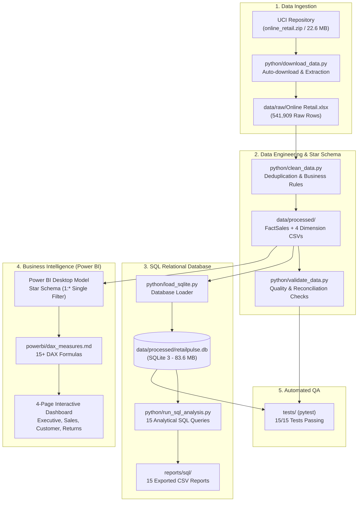
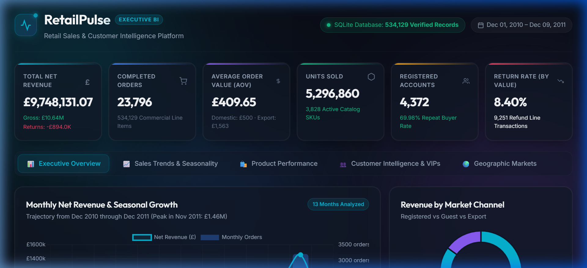
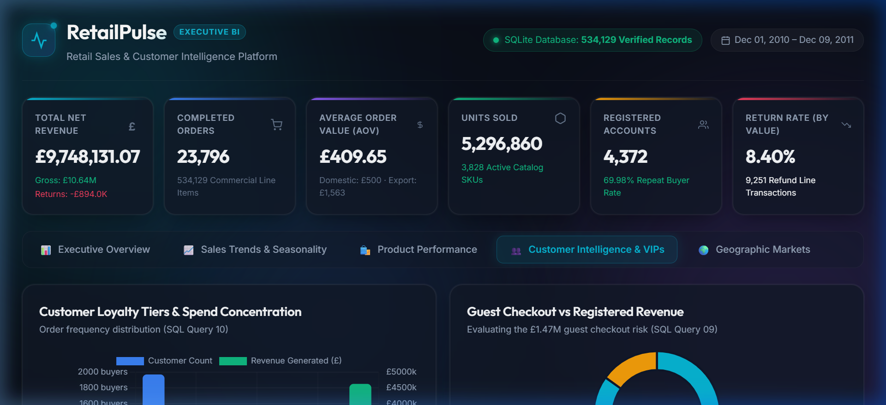

# RetailPulse — Retail Sales & Customer Intelligence Analytics Platform

[](https://www.python.org/)
[](https://www.sqlite.org/)
[](https://powerbi.microsoft.com/)
[](tests/)
[](LICENSE)
[](https://creativecommons.org/licenses/by/4.0/)

An end-to-end retail business intelligence and customer analytics portfolio platform built from historical 2010–2011 retail transactional data (UK giftware e-commerce). RetailPulse ingests raw transactional records, enforces rigorous data cleaning and dimensional modeling, establishes an embedded relational SQLite Star Schema database with 15 analytical business queries, provides an interactive local executive web dashboard, and documents an executive Power BI reporting suite with advanced DAX time-intelligence formulas.

---

## 1. Project Overview & Business Problem

Modern e-commerce and multi-channel retailers face critical questions around revenue growth, customer retention, and operational efficiency:
- Which products drive genuine commercial revenue versus high return rates?
- How heavily does revenue concentrate among top repeat buyers versus one-time purchasers?
- How does international wholesale purchasing differ in basket size and return friction from domestic sales?
- How can a business analyze guest checkout revenue without corrupting customer lifetime metrics?

**RetailPulse** answers these questions by turning **541,909 raw transactional records** (Dec 2010 – Dec 2011) into an analysis-ready Star Schema, extracting measurable business findings, and providing evidence-backed executive recommendations.

---

## 2. Dataset Source & Attribution

- **Dataset**: Online Retail Dataset
- **Repository**: [UCI Machine Learning Repository (Dataset ID: 352)](https://archive.ics.uci.edu/dataset/352/online+retail)
- **Donor**: Dr. Daqing Chen, Director of Public Analytics group, London South Bank University
- **License**: [Creative Commons Attribution 4.0 International (CC BY 4.0)](https://creativecommons.org/licenses/by/4.0/)
- **Citation**: Chen, D., Sain, S. L., & Guo, K. (2012). *Data mining for the online retail industry: A case study of RFM model-based customer segmentation using data mining*. Journal of Database Marketing & Customer Strategy Management, 19(3), 197–208.
- **Historical Scope**: All transactions occurring between **01/12/2010 and 09/12/2011** for a UK-based registered online retailer specializing in giftware and decorative merchandise.

---

## 3. Technology Stack

- **Python (3.10–3.13)**: Data engineering, profiling, automated cleaning, and star-schema generation (`pandas`, `numpy`, `openpyxl`, `requests`).
- **SQL / Relational Database**: **SQLite 3** for schema creation, indexing, primary/foreign key constraints, and analytical business queries.
- **Web Dashboard**: Interactive dark-mode dashboard built with Vanilla HTML5, CSS3, JavaScript, and Chart.js.
- **Power BI Desktop**: 4-page visual blueprint and Star Schema data model documentation.
- **DAX (Data Analysis Expressions)**: 15+ analytical measures covering time intelligence, customer retention, and refund rates.
- **Testing & Quality Assurance**: **pytest** test suite with 21 automated unit/integration tests verifying data integrity, constraints, and query idempotence.
- **Version Control**: Git & GitHub.

---

## 4. End-to-End Pipeline Architecture



---

## 5. Data Cleaning & Numerical Reconciliation

Every row and pound sterling is traceable through the transformation pipeline:

| Pipeline Stage | Record Count | % of Raw Data | Financial Value (£ GBP) | Classification & Rationale |
| :--- | :---: | :---: | :---: | :--- |
| **Raw Ingested Records** | **541,909** | **100.00%** | N/A | Original unaltered Excel source truth |
| **Exact Duplicate Rows Removed** | **-5,268** | **-0.97%** | N/A | Duplicate order rows from web checkout double-clicks |
| **Deduplicated Working Baseline** | **536,641** | **99.03%** | N/A | Clean working transaction set |
| **Administrative Exclusions (`UnitPrice <= 0`)** | **-2,512** | **-0.46%** | -£11,062.06 | Internal non-commercial adjustments removed |
| *-> Negative Qty without 'C' (Damaged/Lost)* | *(1,336)* | *(0.25%)* | *£0.00* | *Warehouse shrinkage write-offs* |
| *-> Bad Debt Accounting Adjustments* | *(2)* | *(0.00%)* | *-£11,062.06* | *Manual accounting corrections* |
| *-> Zero Price Positive Quantity* | *(1,174)* | *(0.22%)* | *£0.00* | *Internal stock checks and free samples* |
| **Cleaned Commercial Transactions** | **534,129** | **98.56%** | **£9,748,131.07** | **Net Commercial Dataset** |
| *-> Positive Sales Transactions* | **524,878** | **96.86%** | **£10,642,110.80** | **Gross Commercial Sales** |
| *-> Customer Returns & Cancellations* | **9,251** | **1.71%** | **-£893,979.73** | **Refund & Cancellation Stream** |

> **Financial Reconciliation Proof**:  
> `Gross Sales (£10,642,110.80) + Returns (-£893,979.73) = £9,748,131.07 (Net Commercial Revenue)`  
> *Variance: £0.00 (Exact to the penny).*

---

## 6. Relational Star Schema Model

The cleaned data is structured into an industry-standard dimensional model:

- **`fact_sales`** (534,129 rows): Transaction line-item grain with foreign keys to all dimensions.
- **`dim_date`** (305 rows): Calendar date dimension marked as the official Date Table.
- **`dim_customer`** (4,372 rows): 4,371 registered loyalty accounts + 1 guest sentinel profile (`customer_id = -1`).
- **`dim_product`** (3,828 rows): Distinct catalog merchandise SKUs.
- **`dim_geography`** (38 rows): Country markets categorized into Domestic UK, EU, and International Export.

---

## 7. Key SQL Analysis Queries

Our SQL repository in [`sql/analysis_queries.sql`](sql/analysis_queries.sql) contains 15 production queries demonstrating CTEs, window functions, and cohort analysis.

### Example: Customer Purchase Frequency & Repeat Retention (Query 10)
```sql
WITH CustomerFrequency AS (
    SELECT 
        customer_id,
        total_orders,
        total_spend,
        CASE 
            WHEN total_orders = 1 THEN '1 Order (One-Time Buyer)'
            WHEN total_orders BETWEEN 2 AND 5 THEN '2-5 Orders (Repeat Customer)'
            WHEN total_orders BETWEEN 6 AND 10 THEN '6-10 Orders (Loyal Customer)'
            ELSE '10+ Orders (VIP / Power Buyer)'
        END AS loyalty_tier
    FROM dim_customer
    WHERE customer_id != -1
)
SELECT 
    loyalty_tier,
    COUNT(*) AS customer_count,
    ROUND(COUNT(*) * 100.0 / (SELECT COUNT(*) FROM dim_customer WHERE customer_id != -1), 2) AS customer_pct,
    ROUND(SUM(total_spend), 2) AS tier_revenue_gbp,
    ROUND(SUM(total_spend) * 100.0 / (SELECT SUM(total_spend) FROM dim_customer WHERE customer_id != -1), 2) AS revenue_pct
FROM CustomerFrequency
GROUP BY loyalty_tier
ORDER BY customer_count DESC;
```
**Key Takeaway**: Repeat customers (2+ orders) represent **69.98% of customers** but drive **94.79% of registered spend**. VIP Power Buyers (10+ orders) represent just **10.50% of accounts** yet generate **55.92% of sales (£4.63M)**.

---

## 8. Five Critical Data-Backed Findings

1. **Extreme Q4 Holiday Seasonality**: Net revenue grew **+194.1%** from £497k in February 2011 to £1.46M in November 2011. Q4 generated **32.2% of annual revenue**.
2. **International Wholesale Basket Multiplier**: While the UK accounts for 84.0% of volume, international export orders average **£1,562.97 per order (3.1x larger)** and **871 units per order (3.4x larger)**.
3. **The 10% VIP Pareto Engine**: Repeat buyers account for **69.98% of accounts** and generate **94.79% of registered revenue**. The #1 customer (`14646` in Netherlands) spent **£279,489.02** across 76 orders.
4. **Export Transit Return Friction**: Long-distance export destinations exhibit elevated return rates (Singapore 57.1%, Hong Kong 36.0%, USA 50.1%), indicating transit damage to fragile items or customs delays.
5. **Guest Checkout Significance**: **15.08% of revenue (£1,469,611.65)** flows through unauthenticated guest checkout, demonstrating the revenue risk of mandatory account barriers.

---

## 9. Executive Dashboards: Web & Power BI

RetailPulse provides two complementary presentation layers for business stakeholders and technical evaluators:

### 9.1 Interactive Local Web Dashboard (Instant Browser Review)
For instant review without requiring Microsoft Power BI Desktop installed, RetailPulse includes an executive dark-mode dashboard built with Vanilla HTML5, CSS3, JavaScript, and Chart.js.

- **Instant Zero-Config Launch**: Run `python python/serve_dashboard.py` and navigate to `http://localhost:8080`.
- **5 Interactive Analysis Tabs**:
  1. **Executive Overview**: High-level KPI banner, monthly net revenue & order volume combo chart, and market channel distribution donut.
  2. **Sales Trends & Seasonality**: Monthly gross sales vs. refund deductions bar chart, cumulative revenue curve to £9.75M, and audited financial table.
  3. **Product Performance**: Top 10 merchandise items by revenue and physical unit volume, with real-time text search filtering.
  4. **Customer Intelligence & VIPs**: Repeat purchase loyalty tier distribution, guest checkout revenue split, and top 10 VIP customer rankings.
  5. **Geographic Markets**: Regional Average Order Value (AOV) comparison, international return friction ranking, and country-level league table.
- **Embedded Lightweight Payload**: Powered by `web/dashboard_data.json` (34 KB), ensuring sub-second load times with zero external database dependencies.

### Dashboard Visual Previews


*Figure 1: Executive Overview tab showing high-level commercial KPIs, monthly revenue growth trajectory, and market channel breakdown.*


*Figure 2: Customer Intelligence tab showcasing repeat purchase loyalty tiers, guest checkout impact, and top 10 VIP customer rankings.*

### 9.2 Power BI Desktop Blueprint & DAX Specification (4 Pages)
Full visual blueprints, layout specifications, and production-tested DAX measures are documented in [`powerbi/dashboard_design.md`](powerbi/dashboard_design.md) and [`powerbi/dax_measures.md`](powerbi/dax_measures.md) 

Rather than committing a proprietary binary `.pbix` file to Git (which inflates repository size and creates merge conflicts), complete click-by-click assembly instructions are provided in [`powerbi/README_POWERBI.md`](powerbi/README_POWERBI.md) so any analyst can assemble the report in Power BI Desktop in approximately 15 minutes:

- **Page 1: Executive Overview**: High-level KPIs (`Net Revenue`, `Gross Sales`, `Total Orders`, `AOV`), monthly sales vs. refund trend line, top 10 products, and regional market share donut.
- **Page 2: Sales Performance**: Expandable Year-Quarter-Month matrix, product price elasticity scatter plot, day-of-week purchasing patterns, and country revenue league table.
- **Page 3: Customer Intelligence**: Registered vs. guest checkout split, new vs. returning monthly cohort spend, purchase frequency loyalty tiers, and top 10 VIP accounts.
- **Page 4: Returns & Strategic Insights**: Monthly refund trend line, top 10 most returned products, country return rate rankings, and five executive recommendation action cards.

---

## 10. Repository Structure

```text
RetailPulse/
├── data/
│   ├── raw/                       <-- Raw dataset directory (excluded by .gitignore)
│   └── processed/                 <-- Cleaned data outputs
│       ├── dim_customer.csv       <-- [Tracked] Customer dimension with guest sentinel (-1)
│       ├── dim_product.csv        <-- [Tracked] Product catalog dimension (3,828 SKUs)
│       ├── dim_date.csv           <-- [Tracked] Calendar date dimension (305 trading dates)
│       ├── dim_geography.csv      <-- [Tracked] Country & market region hierarchy (38 countries)
│       ├── returns_cancellations.csv <-- [Tracked] All 9,251 refund records (1.6 MB)
│       ├── data_quality_report.csv <-- [Tracked] Pipeline reconciliation summary
│       ├── retailpulse.db         <-- [Ignored] SQLite database (83.6 MB, built via load_sqlite.py)
│       ├── cleaned_transactions.csv <-- [Ignored] Full clean dataset (89.5 MB, built via clean_data.py)
│       ├── sales_transactions.csv <-- [Ignored] Sales-only flat file (87.9 MB, built via clean_data.py)
│       └── fact_sales.csv         <-- [Ignored] Fact table extract (38.1 MB, built via clean_data.py)
├── python/
│   ├── download_data.py           <-- Automated ingestion from UCI repository
│   ├── profile_data.py            <-- Dataset profiling engine
│   ├── clean_data.py              <-- Preprocessing & Star Schema generation
│   ├── validate_data.py           <-- Data quality audit script
│   ├── load_sqlite.py             <-- SQLite database loader & reconciliation validator
│   ├── run_sql_analysis.py        <-- SQL query execution & CSV exporter
│   ├── export_dashboard_data.py   <-- Dashboard JSON payload exporter
│   ├── serve_dashboard.py         <-- Local dashboard HTTP server
│   └── init_git_repo.py           <-- Git safety audit & publisher script
├── sql/
│   ├── schema.sql                 <-- Relational Star Schema DDL (tables, PKs, FKs, indexes)
│   └── analysis_queries.sql       <-- 15 analytical business queries
├── powerbi/
│   ├── README_POWERBI.md          <-- Step-by-step Power BI Desktop assembly guide
│   ├── data_model.md              <-- Relationship & technical specifications
│   ├── dax_measures.md            <-- Production DAX measure formulas
│   └── dashboard_design.md        <-- 4-page visual blueprint & design tokens
├── web/
│   ├── index.html                 <-- Executive dark-mode dashboard interface
│   ├── style.css                  <-- Responsive design system & glassmorphism tokens
│   ├── app.js                     <-- Interactive tab routing & chart rendering logic
│   ├── chart.min.js               <-- Embedded Chart.js charting engine
│   └── dashboard_data.json        <-- Pre-computed high-speed analytics payload (34 KB)
├── reports/
│   ├── figures/                   <-- Verified dashboard screenshots
│   ├── sql/                       <-- 15 exported query CSV results
│   ├── data_profile.md            <-- Raw profiling audit report
│   ├── data_quality_report.md     <-- Data transformation quality report
│   ├── business_insights.md       <-- Executive business findings report
│   └── final_quality_report.md    <-- End-to-end verification audit
├── docs/
│   ├── setup_guide.md             <-- Beginner Windows setup guide
│   ├── architecture.md            <-- System architecture & flow
│   ├── data_dictionary.md         <-- Column definitions & constraints
│   ├── data_cleaning_methodology.md <-- Cleaning logic & reconciliation
│   ├── sql_database_design.md     <-- Relational schema documentation
│   ├── sql_query_guide.md         <-- SQL query reference & explanations
│   ├── github_publish_guide.md    <-- Git & GitHub portfolio deployment
│   └── job_application_materials.md <-- Resume bullets, interview Q&A, and project talking points
├── tests/
│   ├── test_data_quality.py       <-- File, data invariant & reconciliation tests
│   └── test_sql_database.py       <-- SQLite schema, constraint & SQL query tests
├── check_env.ps1                  <-- Automated environment diagnostic script
├── requirements.txt               <-- Python dependencies
├── .gitignore                     <-- Repository exclusions
├── LICENSE                        <-- MIT License with dataset attribution notice
└── README.md
```

---

## 11. Quickstart & Reproduction Guide (Windows)

Open PowerShell in the project directory and run:

```powershell
# 1. Create and activate a Python virtual environment
python -m venv .venv
.\.venv\Scripts\Activate.ps1

# 2. Verify environment readiness
powershell -ExecutionPolicy Bypass -File .\check_env.ps1

# 3. Install analytical dependencies
pip install -r requirements.txt

# 4. Ingest and profile raw UCI data
python python/download_data.py
python python/profile_data.py

# 5. Clean data, generate Star Schema tables, and validate
python python/clean_data.py
python python/validate_data.py

# 6. Load SQLite relational database
python python/load_sqlite.py

# 7. Execute all 15 SQL analytical queries and export reports
python python/run_sql_analysis.py
python python/export_dashboard_data.py

# 8. Run automated test suite (21/21 passing)
pytest tests/ -v

# 9. Launch interactive executive web dashboard in your browser
python python/serve_dashboard.py
# (Dashboard opens at http://localhost:8080)
```

---

## 12. Analytical Boundaries & Future Roadmap

- **Cost of Goods Sold (COGS)**: The raw dataset contains retail selling prices but zero product supplier acquisition costs. Gross margin and net margin are intentionally omitted to uphold institutional data integrity. All reported metrics strictly represent **Gross Sales and Net Revenue**.
- **Historical 2010–2011 Window**: The dataset spans December 1, 2010 through December 9, 2011. December 2011 reflects only 9 active trading days and must not be evaluated as a full month in period comparisons.
- **RFM Customer Segmentation**: Future enhancement planned to implement ML-based RFM (Recency, Frequency, Monetary) clustering with Python `scikit-learn`.

---

## License & Attribution

- **Project Code & Documentation**: Licensed under the [MIT License](LICENSE).
- **Dataset Attribution**: Online Retail Dataset from the [UCI Machine Learning Repository](https://archive.ics.uci.edu/dataset/352/online+retail), distributed under the [Creative Commons Attribution 4.0 International (CC BY 4.0)](https://creativecommons.org/licenses/by/4.0/) license. Citation: Chen, D., Sain, S. L., & Guo, K. (2012). *Data mining for the online retail industry*. Journal of Database Marketing & Customer Strategy Management, 19(3), 197–208.
