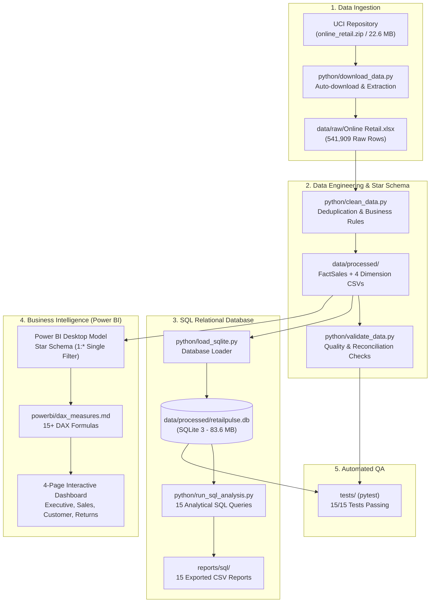

# RetailPulse — Retail Sales & Customer Intelligence Analytics Platform

[](https://www.python.org/)
[](https://www.sqlite.org/)
[](https://powerbi.microsoft.com/)
[](tests/)
[](https://creativecommons.org/licenses/by/4.0/)

An end-to-end retail business intelligence and customer analytics solution built from genuine transactional data. RetailPulse ingests raw e-commerce records, enforces rigorous data cleaning and dimensional modeling, establishes an embedded relational SQL database with 15+ production business queries, and models an executive Power BI dashboard with advanced DAX time-intelligence calculations.

---

## 1. Project Overview & Business Problem

Modern e-commerce and multi-channel retailers face critical questions around revenue growth, customer retention, and operational efficiency:
- Which products drive genuine commercial revenue versus high return rates?
- How heavily does revenue concentrate among top repeat buyers versus one-time purchasers?
- How does international wholesale purchasing differ in basket size and return friction from domestic sales?
- How can a business analyze guest checkout revenue without corrupting customer lifetime metrics?

**RetailPulse** answers these questions by turning **541,909 raw transactional records** into an analysis-ready Star Schema, extracting measurable business findings, and providing evidence-backed executive recommendations.

---

## 2. Dataset Source & Attribution

- **Dataset**: Online Retail Dataset
- **Repository**: [UCI Machine Learning Repository (Dataset ID: 352)](https://archive.ics.uci.edu/dataset/352/online+retail)
- **Donor**: Dr. Daqing Chen, Director of Public Analytics group, London South Bank University
- **License**: [Creative Commons Attribution 4.0 International (CC BY 4.0)](https://creativecommons.org/licenses/by/4.0/)
- **Citation**: Chen, D., Sain, S. L., & Guo, K. (2012). *Data mining for the online retail industry: A case study of RFM model-based customer segmentation using data mining*. Journal of Database Marketing & Customer Strategy Management, 19(3), 197–208.
- **Scope**: All transactions occurring between **01/12/2010 and 09/12/2011** for a UK-based registered online retailer specializing in giftware and decorative merchandise.

---

## 3. Technology Stack

- **Python (3.12)**: Data engineering, profiling, automated cleaning, and star-schema generation (`pandas`, `numpy`, `openpyxl`, `requests`).
- **SQL / Relational Database**: **SQLite 3** for schema creation, indexing, primary/foreign key constraints, and business analytics.
- **Power BI Desktop**: Interactive 4-page executive reporting suite with Star Schema data modeling.
- **DAX (Data Analysis Expressions)**: 15+ analytical measures covering time intelligence, customer retention, and refund rates.
- **Testing & Quality Assurance**: **pytest** test suite with 15 automated integration tests verifying data integrity.
- **Version Control**: Git & GitHub.

---

## 4. End-to-End Pipeline Architecture



---

## 5. Data Cleaning & Numerical Reconciliation

Every row and pound sterling is traceable through the transformation pipeline:

| Pipeline Stage | Record Count | % of Raw Data | Financial Value (£ GBP) | Classification & Rationale |
| :--- | :---: | :---: | :---: | :--- |
| **Raw Ingested Records** | **541,909** | **100.00%** | N/A | Original unaltered Excel source truth |
| **Exact Duplicate Rows Removed** | **-5,268** | **-0.97%** | N/A | Duplicate order rows from web checkout double-clicks |
| **Deduplicated Working Baseline** | **536,641** | **99.03%** | N/A | Clean working transaction set |
| **Administrative Exclusions (`UnitPrice <= 0`)** | **-2,512** | **-0.46%** | -£11,062.06 | Internal non-commercial adjustments removed |
| *-> Negative Qty without 'C' (Damaged/Lost)* | *(1,336)* | *(0.25%)* | *£0.00* | *Warehouse shrinkage write-offs* |
| *-> Bad Debt Accounting Adjustments* | *(2)* | *(0.00%)* | *-£11,062.06* | *Manual accounting corrections* |
| *-> Zero Price Positive Quantity* | *(1,174)* | *(0.22%)* | *£0.00* | *Internal stock checks and free samples* |
| **Cleaned Commercial Transactions** | **534,129** | **98.56%** | **£9,748,131.07** | **Net Commercial Dataset** |
| *-> Positive Sales Transactions* | **524,878** | **96.86%** | **£10,642,110.80** | **Gross Commercial Sales** |
| *-> Customer Returns & Cancellations* | **9,251** | **1.71%** | **-£893,979.73** | **Refund & Cancellation Stream** |

> **Financial Reconciliation Proof**:  
> `Gross Sales (£10,642,110.80) + Returns (-£893,979.73) = £9,748,131.07 (Net Commercial Revenue)`  
> *Variance: £0.00 (Exact to the penny).*

---

## 6. Relational Star Schema Model

The cleaned data is structured into an industry-standard dimensional model:

- **`fact_sales`** (534,129 rows): Transaction line-item grain with foreign keys to all dimensions.
- **`dim_date`** (305 rows): Calendar date dimension marked as the official Date Table.
- **`dim_customer`** (4,372 rows): 4,371 registered loyalty accounts + 1 guest sentinel profile (`customer_id = -1`).
- **`dim_product`** (3,828 rows): Distinct catalog merchandise SKUs.
- **`dim_geography`** (38 rows): Country markets categorized into Domestic UK, EU, and International Export.

---

## 7. Key SQL Analysis Queries

Our SQL repository in [`sql/analysis_queries.sql`](sql/analysis_queries.sql) contains 15 production queries demonstrating CTEs, window functions, and cohort analysis.

### Example: Customer Purchase Frequency & Repeat Retention (Query 10)
```sql
WITH CustomerFrequency AS (
    SELECT 
        customer_id,
        total_orders,
        total_spend,
        CASE 
            WHEN total_orders = 1 THEN '1 Order (One-Time Buyer)'
            WHEN total_orders BETWEEN 2 AND 5 THEN '2-5 Orders (Repeat Customer)'
            WHEN total_orders BETWEEN 6 AND 10 THEN '6-10 Orders (Loyal Customer)'
            ELSE '10+ Orders (VIP / Power Buyer)'
        END AS loyalty_tier
    FROM dim_customer
    WHERE customer_id != -1
)
SELECT 
    loyalty_tier,
    COUNT(*) AS customer_count,
    ROUND(COUNT(*) * 100.0 / (SELECT COUNT(*) FROM dim_customer WHERE customer_id != -1), 2) AS customer_pct,
    ROUND(SUM(total_spend), 2) AS tier_revenue_gbp,
    ROUND(SUM(total_spend) * 100.0 / (SELECT SUM(total_spend) FROM dim_customer WHERE customer_id != -1), 2) AS revenue_pct
FROM CustomerFrequency
GROUP BY loyalty_tier
ORDER BY customer_count DESC;
```
**Key Takeaway**: Repeat customers (2+ orders) represent **69.98% of customers** but drive **94.79% of registered spend**. VIP Power Buyers (10+ orders) represent just **10.50% of accounts** yet generate **55.92% of sales (£4.63M)**.

---

## 8. Five Critical Data-Backed Findings

1. **Extreme Q4 Holiday Seasonality**: Net revenue grew **+194.1%** from £497k in February 2011 to £1.46M in November 2011. Q4 generated **32.2% of annual revenue**.
2. **International Wholesale Basket Multiplier**: While the UK accounts for 84.0% of volume, international export orders average **£1,562.97 per order (3.1x larger)** and **871 units per order (3.4x larger)**.
3. **The 10% VIP Pareto Engine**: Repeat buyers account for **69.98% of accounts** and generate **94.79% of registered revenue**. The #1 customer (`14646` in Netherlands) spent **£279,489.02** across 76 orders.
4. **Export Transit Return Friction**: Long-distance export destinations exhibit elevated return rates (Singapore 57.1%, Hong Kong 36.0%, USA 50.1%), indicating transit damage to fragile items or customs delays.
5. **Guest Checkout Significance**: **15.08% of revenue (£1,469,611.65)** flows through unauthenticated guest checkout, demonstrating the revenue risk of mandatory account barriers.

---

## 9. Power BI Dashboard Blueprint (4 Pages)

Full visual blueprints and DAX measures are documented in [`powerbi/dashboard_design.md`](powerbi/dashboard_design.md) and [`powerbi/dax_measures.md`](powerbi/dax_measures.md):

- **Page 1: Executive Overview**: High-level KPIs (`Net Revenue`, `Gross Sales`, `Total Orders`, `AOV`), monthly sales vs. refund trend line, top 10 products, and regional market share donut.
- **Page 2: Sales Performance**: Expandable Year-Quarter-Month matrix, product price elasticity scatter plot, day-of-week purchasing patterns, and country revenue league table.
- **Page 3: Customer Intelligence**: Registered vs. guest checkout split, new vs. returning monthly cohort spend, purchase frequency loyalty tiers, and top 10 VIP accounts.
- **Page 4: Returns & Strategic Insights**: Monthly refund trend line, top 10 most returned products, country return rate rankings, and five executive recommendations cards.

### Dashboard Visual Preview Placeholders

```text
+----------------------------------------------------------------------------------------------------+
| [SCREENSHOT PLACEHOLDER: Page 1 — Executive Overview]                                              |
| Note: Assemble your finished RetailPulse.pbix using powerbi/README_POWERBI.md, take a screenshot,  |
| and save it to reports/figures/page1_executive_overview.png                                         |
+----------------------------------------------------------------------------------------------------+
```

```text
+----------------------------------------------------------------------------------------------------+
| [SCREENSHOT PLACEHOLDER: Page 3 — Customer Intelligence]                                           |
| Note: Assemble your finished RetailPulse.pbix using powerbi/README_POWERBI.md, take a screenshot,  |
| and save it to reports/figures/page3_customer_intelligence.png                                     |
+----------------------------------------------------------------------------------------------------+
```

---

## 10. Repository Structure

```text
RetailPulse/
├── data/
│   ├── raw/                       <-- Raw dataset (auto-downloaded via script)
│   └── processed/                 <-- Cleaned Star Schema CSVs & SQLite DB
│       ├── cleaned_transactions.csv
│       ├── sales_transactions.csv
│       ├── returns_cancellations.csv
│       ├── fact_sales.csv
│       ├── dim_customer.csv
│       ├── dim_product.csv
│       ├── dim_date.csv
│       ├── dim_geography.csv
│       ├── data_quality_report.csv
│       └── retailpulse.db         <-- SQLite relational database (83.6 MB)
├── python/
│   ├── download_data.py           <-- Automated download and unzipping
│   ├── profile_data.py            <-- Dataset profiling engine
│   ├── clean_data.py              <-- Preprocessing & Star Schema generation
│   ├── validate_data.py           <-- Data quality audit script
│   ├── load_sqlite.py             <-- Database DDL & data loader
│   └── run_sql_analysis.py        <-- SQL query execution & CSV exporter
├── sql/
│   ├── schema.sql                 <-- Relational Star Schema DDL
│   └── analysis_queries.sql       <-- 15 analytical production queries
├── powerbi/
│   ├── README_POWERBI.md          <-- Click-by-click Desktop build guide
│   ├── data_model.md              <-- Relationship & technical specifications
│   ├── dax_measures.md            <-- Production DAX measure formulas
│   └── dashboard_design.md        <-- 4-page visual blueprint & color tokens
├── reports/
│   ├── figures/                   <-- Screenshots and charts
│   ├── sql/                       <-- 15 exported query CSV results
│   ├── data_profile.md            <-- Raw profiling audit report
│   ├── data_quality_report.md     <-- Data transformation quality report
│   ├── business_insights.md       <-- Executive business findings report
│   └── final_quality_report.md    <-- End-to-end verification audit
├── docs/
│   ├── setup_guide.md             <-- Beginner Windows setup guide
│   ├── architecture.md            <-- System architecture & flow
│   ├── data_dictionary.md         <-- Column definitions & constraints
│   ├── data_cleaning_methodology.md <-- Cleaning logic & reconciliation
│   ├── sql_database_design.md     <-- Relational schema documentation
│   ├── sql_query_guide.md         <-- SQL query reference & explanations
│   ├── github_publish_guide.md    <-- Git & GitHub portfolio deployment
│   └── job_application_materials.md <-- Resume bullets, LinkedIn post, Q&A
├── tests/
│   ├── test_data_quality.py       <-- File & data reconciliation tests
│   └── test_sql_database.py       <-- SQLite schema & SQL query tests
├── check_env.ps1                  <-- Automated environment diagnostic script
├── requirements.txt               <-- Python dependencies
├── .gitignore
└── README.md
```

---

## 11. Quickstart & Reproduction Guide (Windows)

Open PowerShell and run:

```powershell
# 1. Clone or navigate to the repository
cd c:\Users\USER\Documents\RetailPulse

# 2. Verify environment readiness
powershell -ExecutionPolicy Bypass -File .\check_env.ps1

# 3. Install analytical dependencies
pip install -r requirements.txt

# 4. Download and profile the dataset
python python/download_data.py
python python/profile_data.py

# 5. Clean data and generate Star Schema
python python/clean_data.py

# 6. Load SQLite relational database
python python/load_sqlite.py

# 7. Execute all 15 SQL analytical queries
python python/run_sql_analysis.py

# 8. Run automated test suite
pytest tests/ -v
```

---

## 12. Limitations & Future Roadmap

- **Cost of Goods Sold (COGS)**: The dataset does not contain wholesale supplier product costs. Gross margin and net margin are intentionally omitted to uphold institutional data integrity. Future enhancements could incorporate synthetic supplier cost schedules for margin sensitivity analysis.
- **Partial December 2011**: Data concludes on December 9, 2011 (9 active days). Evaluations must avoid comparing Dec 2011 as a full month.
- **RFM Customer Scoring**: Next phase will implement machine-learning-based RFM (Recency, Frequency, Monetary) customer segmentation using Python scikit-learn.

---

## License

This project utilizes data from the UCI Machine Learning Repository distributed under the **Creative Commons Attribution 4.0 International (CC BY 4.0)** license. Project code and documentation are released under the MIT License.
