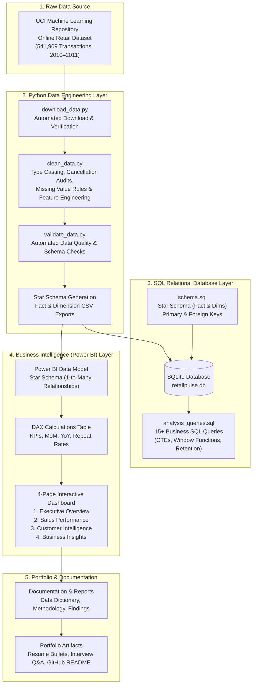

# RetailPulse — Project Architecture & Workflow

## 1. What is RetailPulse?
**RetailPulse** is an end-to-end retail sales and customer intelligence analytics solution built from genuine transactional data. It simulates the exact workflow of a corporate Data Analyst / Business Intelligence Developer:
1. Ingesting raw enterprise transactional data.
2. Cleaning, validating, and structuring data into an industry-standard **Star Schema**.
3. Storing and querying data inside an **SQL Relational Database** using advanced SQL.
4. Building an executive **Power BI Dashboard** with DAX time-intelligence measures.
5. Extracting actionable business findings and packaging the project for hiring managers.

---

## 2. End-to-End Data Pipeline Architecture

---

## 3. Detailed Component Breakdown

### Layer 1: Raw Data Ingestion
- **Dataset Source**: University of California Irvine (UCI) Machine Learning Repository.
- **Coverage**: All transactions occurring between 01/12/2010 and 09/12/2011 for a UK-based non-store online retailer selling giftware.
- **Volume**: 541,909 raw records, 8 core attributes (`InvoiceNo`, `StockCode`, `Description`, `Quantity`, `InvoiceDate`, `UnitPrice`, `CustomerID`, `Country`).
- **Access Route**: Direct HTTP retrieval of `online+retail.zip` with verification and fallback instructions.

### Layer 2: Python Data Engineering & Cleaning
- **Type Conversions**: Parse `InvoiceDate` to proper datetime format; convert `Quantity` to integer and `UnitPrice` to floating-point numeric.
- **Cancellations & Returns**: Identify invoices beginning with `"C"`. In retail, these represent order cancellations or customer product returns. We preserve return records with a clear `IsReturn` flag so net sales and gross sales can both be analyzed accurately.
- **Missing Customer IDs**: In e-commerce, guest checkouts often have null customer IDs. We segregate registered customers from guest transactions rather than blindly deleting records, explaining the business impact.
- **Enriched Time Features**: Extract `OrderDate`, `Year`, `Quarter`, `Month`, `MonthName`, `DayOfWeek`, and line-item `TotalAmount` (`Quantity * UnitPrice`).
- **Star Schema Generation**: Export optimized tabular files:
  - `fact_sales.csv`
  - `dim_customer.csv`
  - `dim_product.csv`
  - `dim_date.csv`
  - `dim_geography.csv`

### Layer 3: Relational SQL Database
- **Engine**: SQLite (zero-configuration, embedded relational engine with full SQL compliance).
- **Schema Design**: Star schema with primary and foreign key constraints.
- **Analytical Coverage**: 15+ SQL business questions answering:
  - Total revenue, monthly trends, and year-over-year growth.
  - Product sales ranking and Pareto contribution (80/20 rule).
  - Country-level sales distribution and international penetration.
  - Customer cohort analysis, repurchase intervals, and customer lifetime value rankings.
  - Window functions (`RANK()`, `ROW_NUMBER()`, `SUM() OVER (ORDER BY...)` running totals).

### Layer 4: Power BI Analytics & DAX
- **Data Modeling**: Pure Star Schema model with single-direction (1-to-many) cross-filtering from dimensions to facts to eliminate circular dependencies or ambiguous paths.
- **Time Intelligence**: Date table with standard calendar sorting (`MonthName` sorted by `MonthNumber`).
- **DAX Measures**: Segregated into a dedicated measure table (`_Measures`), covering:
  - Total Net Sales, Gross Sales, Return Value, and Return Rate %.
  - Total Orders, Average Order Value (AOV), and Items per Order.
  - Customer Metrics: Active Customers, Repeat Customer Rate %, New Customers, Returning Customers.
  - Time Intelligence: Month-over-Month (MoM) Growth %, Year-over-Year (YoY) Growth %, Previous Month Sales.
- **Dashboard Blueprint**:
  - **Page 1: Executive Overview**: High-level KPIs, monthly trend line, geographic breakdown, top 10 products.
  - **Page 2: Sales Performance**: Monthly and quarterly sales patterns, product mix, volume vs. value analysis.
  - **Page 3: Customer Intelligence**: Customer retention, repeat purchase behavior, revenue deciles, guest vs. registered mix.
  - **Page 4: Business Insights & Strategy**: Executive findings, margin opportunities, cross-border expansion recommendations, and data governance caveats.

### Layer 5: Testing & Quality Assurance
- **Automated Validation**: Unit and data quality tests (`pytest tests/test_data_quality.py`) verifying schema integrity, non-null primary keys, valid date bounds, and calculation reconciliation.
