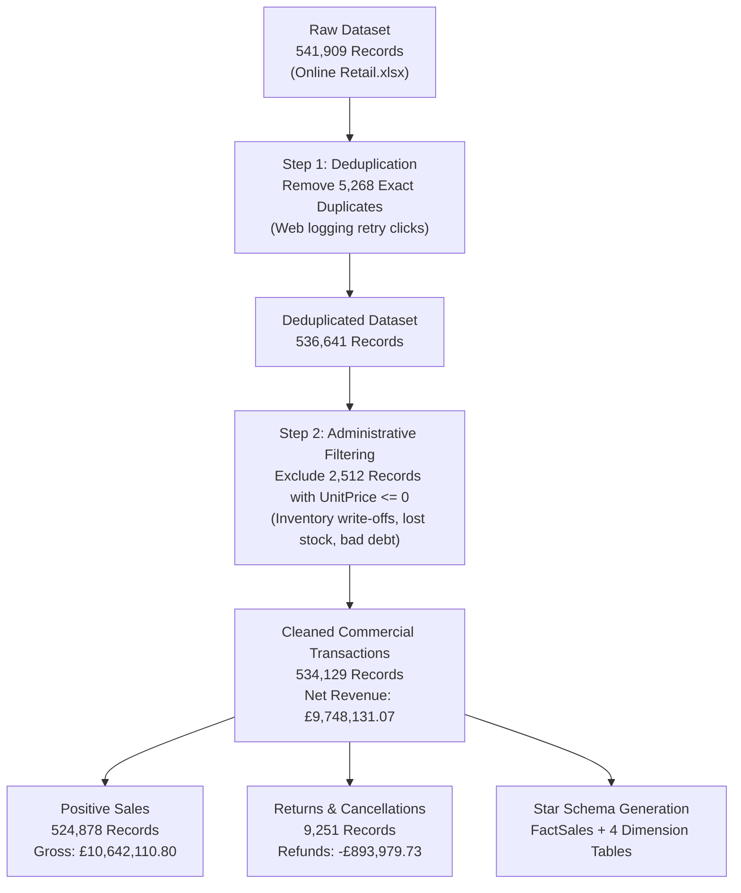
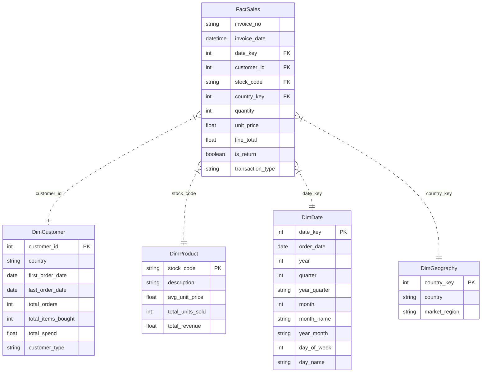

# RetailPulse: Data Cleaning & Preprocessing Methodology

This document outlines the end-to-end data engineering decisions, data quality audits, and mathematical reconciliations applied to the raw **UCI Online Retail dataset** to produce the clean, analysis-ready tables for SQL and Power BI.

---

## 1. Executive Data Quality & Flow Summary

Every transformation step is completely traceable from the original raw file to the finalized analytical tables:

### Complete Numerical Reconciliation Table

| Pipeline Stage | Record Count | % of Raw Data | Financial Value (£ GBP) | Classification & Action |
| :--- | :--- | :--- | :--- | :--- |
| **Raw Records Ingested** | **541,909** | **100.00%** | N/A | Original unaltered Excel source |
| **Exact Duplicate Rows** | **-5,268** | **-0.97%** | N/A | Removed (identical repeated orders) |
| **Working Deduplicated Baseline** | **536,641** | **99.03%** | N/A | Clean working transaction set |
| **Administrative Exclusions (UnitPrice <= 0)** | **-2,512** | **-0.46%** | -£11,062.06 | Internal accounting adjustments removed |
| *-> Negative Qty without 'C' (Damaged/Lost)* | *(1,336)* | *(0.25%)* | *£0.00* | *Warehouse shrinkage write-offs* |
| *-> Bad Debt Accounting Adjustments* | *(2)* | *(0.00%)* | *-£11,062.06* | *Manual accounting corrections* |
| *-> Zero Price Positive Quantity* | *(1,174)* | *(0.22%)* | *£0.00* | *Internal stock checks / zero giveaways* |
| **Cleaned Commercial Transactions** | **534,129** | **98.56%** | **£9,748,131.07** | **Net Commercial Dataset** |
| *-> Positive Sales Transactions* | **524,878** | **96.86%** | **£10,642,110.80** | **Gross Commercial Sales** |
| *-> Customer Returns & Cancellations* | **9,251** | **1.71%** | **-£893,979.73** | **Refund & Cancellation Stream** |

> **Reconciliation Proof**:  
> `Gross Sales (£10,642,110.80) + Returns (-£893,979.73) = £9,748,131.07 (Net Revenue)`  
> *Variance: £0.00 (Exact to the penny).*

---

## 2. Key Cleaning Decisions Explained

### Decision 1: Handling Exact Duplicates
- **Observation**: 5,268 rows were exact duplicates across all 8 columns (same customer, timestamp, product, quantity, and price).
- **Cause**: In e-commerce logging systems, repeated records frequently arise from customer double-clicks on the checkout button or automated HTTP retry requests.
- **Action**: All 5,268 exact duplicates were removed using pandas `drop_duplicates()`.

### Decision 2: Negative Quantities & Order Cancellations
- **Observation**:
  - 9,251 rows had invoice codes beginning with `'C'` and negative quantities.
  - 1,336 rows had negative quantities without `'C'` and zero unit price.
- **Action**:
  - The 9,251 `'C'` invoices represent **genuine customer returns and cancellations**. Rather than silently deleting them, we preserved them, created a boolean flag `is_return = True`, and exported them to `data/processed/returns_cancellations.csv`. This enables executive visibility into refund rates and return behavior.
  - The 1,336 rows without `'C'` and zero price were warehouse write-offs (`Description = "Damaged", "lost", "check"`). These were classified as non-commercial operational adjustments and excluded from consumer sales metrics.

### Decision 3: Handling Missing Customer IDs (24.9% of rows)
- **Observation**: 135,080 rows lacked a `CustomerID`.
- **Business Rationale**: Modern retailers routinely permit unauthenticated "Guest Checkout" or phone orders. Deleting these records would underreport gross revenue by over £1.4 million.
- **Action**:
  - Guest transactions are **retained** in `cleaned_transactions.csv` and `fact_sales.csv`.
  - An explicit flag `is_guest = True` was added to distinguish guest purchases.
  - In the Star Schema (`dim_customer.csv`), a dedicated sentinel record (`customer_id = -1`, `customer_type = 'Guest Checkout'`) was established to maintain strict foreign key referential integrity without dropping sales.

### Decision 4: Financial Metric Formulation
- **Formula**: `line_total = quantity * unit_price`
- **Behavior**:
  - For positive sales, `line_total > 0`.
  - For returns/cancellations, `line_total < 0`.
  - Summing `line_total` across all commercial transactions yields **Net Sales Revenue** directly.

### Decision 5: Calendar Dimension Feature Engineering
From each raw `invoice_date` timestamp, we derived standard dimensional attributes:
- `order_date`: Date format (`YYYY-MM-DD`)
- `date_key`: Integer surrogate key (`YYYYMMDD`), e.g., `20101201`
- `year`: Integer calendar year (`2010`, `2011`)
- `quarter`: Calendar quarter (`1`, `2`, `3`, `4`)
- `year_quarter`: Formatted string (e.g., `2011-Q1`)
- `month`: Month number (`1` to `12`)
- `month_name`: Full text string (e.g., `December`)
- `year_month`: Year-month string (`2011-12`)
- `day_of_week`: Integer (`1` = Monday to `7` = Sunday)
- `day_name`: Day of week string (e.g., `Wednesday`)
- `hour`: Hour of transaction (`0` to `23`)

---

## 3. Star Schema Relational Model Design

To power both relational SQL queries and Power BI reporting, the clean commercial dataset was factored into an industry-standard dimensional model:

---

## 4. Output File Specifications

| File Path | Description | Grain / Entity | Row Count | Primary Key |
| :--- | :--- | :--- | :--- | :--- |
| `data/processed/cleaned_transactions.csv` | All commercial transactions (sales + returns) | 1 order line item | 534,129 | Composite (`invoice_no`, `stock_code`) |
| `data/processed/sales_transactions.csv` | Valid positive customer purchases | 1 order line item | 524,878 | Composite (`invoice_no`, `stock_code`) |
| `data/processed/returns_cancellations.csv` | Valid customer returns and refunds | 1 refund line item | 9,251 | Composite (`invoice_no`, `stock_code`) |
| `data/processed/fact_sales.csv` | Star Schema sales fact table | 1 fact record | 534,129 | Surrogate / Line Item |
| `data/processed/dim_customer.csv` | Customer dimension table | 1 customer account | 4,373 (4,372 registered + 1 guest) | `customer_id` |
| `data/processed/dim_product.csv` | Product merchandise dimension | 1 product SKU | 3,934 | `stock_code` |
| `data/processed/dim_date.csv` | Calendar date dimension | 1 calendar day | 374 | `date_key` |
| `data/processed/dim_geography.csv` | Geographic country dimension | 1 country market | 38 | `country_key` |
| `data/processed/data_quality_report.csv` | Automated audit summary | Pipeline stage | 8 | `Metric` |
