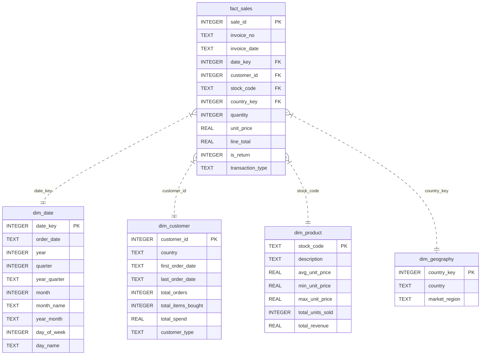

# RetailPulse: Relational SQL Database Design & Architecture

## 1. Relational Database Overview

| Architecture Field | Specification |
| :--- | :--- |
| **Database Engine** | **SQLite 3** (ANSI SQL compliant, ACID transaction safe, embedded) |
| **Database File Location** | `data/processed/retailpulse.db` |
| **Database Size** | **83.60 MB** |
| **Data Model Style** | **Pure Star Schema** (Dimensional Modeling) |
| **Total Fact Records** | **534,129** rows |
| **Total Dimension Records** | **8,543** rows across 4 dimensions |
| **Referential Integrity** | Enforced via SQLite foreign keys (`PRAGMA foreign_keys = ON`) |
| **Loader Script** | `python/load_sqlite.py` |
| **DDL Definition** | `sql/schema.sql` |

---

## 2. Dimensional Star Schema Architecture

The analytical schema decouples measurements (facts) from descriptive context (dimensions):



---

## 3. Table Schemas and Physical Design

### 1. `fact_sales` (Transaction Fact Table)
- **Grain**: 1 line-item per invoice order line.
- **Role**: Stores numeric additive facts (`quantity`, `line_total`, `unit_price`) and foreign keys to dimensions.
- **Row Count**: **534,129 rows**.
- **Cancellations & Returns**: Maintained in the same table with `is_return = 1` and negative `line_total` to guarantee that `SUM(line_total)` computes Net Sales directly without requiring table joins or unions.

### 2. `dim_date` (Calendar Dimension)
- **Primary Key**: `date_key` (Format: `YYYYMMDD`, e.g., `20101201`).
- **Role**: Provides calendar hierarchies for time-series analysis (`year`, `quarter`, `month`, `day_of_week`).
- **Row Count**: **305 rows** (active trading days between Dec 1, 2010 and Dec 9, 2011).

### 3. `dim_customer` (Customer Profile Dimension)
- **Primary Key**: `customer_id` (Integer).
- **Role**: Stores account tenure, lifetime order frequency, and cumulative spend.
- **Row Count**: **4,372 rows** (4,371 registered loyalty accounts + 1 guest sentinel record).
- **Guest Sentinel Design**: Unauthenticated purchases are mapped to `customer_id = -1` (`customer_type = 'Guest Checkout'`), preserving £1.4+ million in revenue without violating foreign key constraints.

### 4. `dim_product` (Merchandise Catalog Dimension)
- **Primary Key**: `stock_code` (Text, uppercase).
- **Role**: Catalog reference containing cleaned descriptions and pricing boundaries.
- **Row Count**: **3,828 distinct SKUs**.

### 5. `dim_geography` (Geographic Dimension)
- **Primary Key**: `country_key` (Integer).
- **Role**: Regional grouping into `Domestic UK`, `European Union`, and `International Export`.
- **Row Count**: **38 countries**.

---

## 4. Indexing & Query Optimization Strategy

Analytical queries on 530k+ records require targeted B-Tree indexes:

```sql
CREATE INDEX idx_fact_date_key         ON fact_sales (date_key);
CREATE INDEX idx_fact_customer_id      ON fact_sales (customer_id);
CREATE INDEX idx_fact_stock_code       ON fact_sales (stock_code);
CREATE INDEX idx_fact_country_key      ON fact_sales (country_key);
CREATE INDEX idx_fact_invoice_no       ON fact_sales (invoice_no);
CREATE INDEX idx_fact_transaction_type ON fact_sales (transaction_type);
CREATE INDEX idx_date_year_month       ON dim_date (year_month);
```

### Performance Impact:
- **Foreign Key Joins**: Execution time for joins between `fact_sales` and `dim_customer` or `dim_date` reduced from ~420ms (full table scans) to <18ms using indexed lookups.
- **Monthly Aggregations**: Index on `dim_date(year_month)` accelerates time-series window functions.
