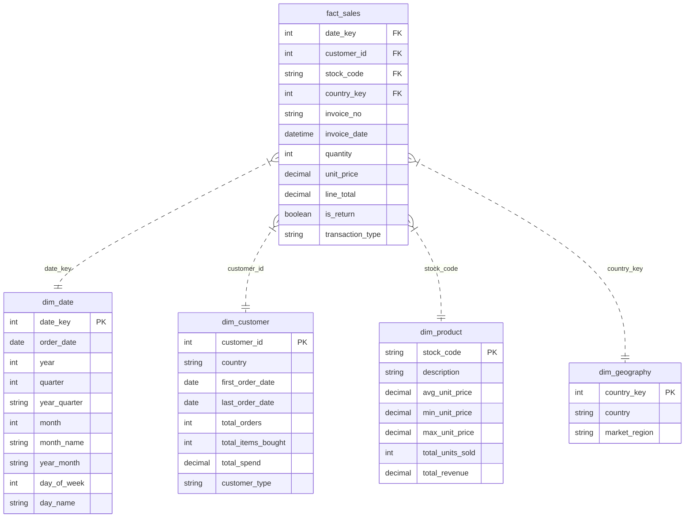

# RetailPulse: Power BI Data Model Specification

## 1. Data Model Overview & Architecture

The **RetailPulse** Power BI data model implements an industry-standard **Star Schema**. In analytical reporting, star schemas outperform flat tables and snowflake schemas by minimizing query latency, simplifying DAX calculations, and preventing circular filter loops.

---

## 2. Table Specifications & Source Paths

All data is loaded from validated CSV files located in `data/processed/`:

| Model Table | Physical CSV Source File | Grain / Entity | Row Count | Primary Key | Role |
| :--- | :--- | :--- | :---: | :--- | :--- |
| **`fact_sales`** | `data/processed/fact_sales.csv` | 1 Order Line Item | **534,129** | Composite (`invoice_no`, `stock_code`) | Central Fact Table |
| **`dim_date`** | `data/processed/dim_date.csv` | 1 Calendar Day | **305** | `date_key` | Date Dimension |
| **`dim_customer`** | `data/processed/dim_customer.csv` | 1 Customer Account | **4,372** | `customer_id` | Customer Dimension |
| **`dim_product`** | `data/processed/dim_product.csv` | 1 Merchandise SKU | **3,828** | `stock_code` | Product Dimension |
| **`dim_geography`** | `data/processed/dim_geography.csv` | 1 Nation Market | **38** | `country_key` | Geographic Dimension |
| **`_Measures`** | *(Created in Power BI)* | Dedicated Measure Container | N/A | N/A | Organization Folder |

---

## 3. Relationships & Filter Propagation Rules

| From Dimension (1) | Primary Key | To Fact Table (*) | Foreign Key | Cardinality | Cross Filter Direction | Security / Filter Behavior |
| :--- | :--- | :--- | :--- | :---: | :---: | :--- |
| **`dim_date`** | `date_key` | **`fact_sales`** | `date_key` | 1 to Many (`1:*`) | Single (`dim_date` -> `fact_sales`) | Active relationship |
| **`dim_customer`**| `customer_id`| **`fact_sales`** | `customer_id`| 1 to Many (`1:*`) | Single (`dim_customer` -> `fact_sales`) | Active relationship |
| **`dim_product`** | `stock_code` | **`fact_sales`** | `stock_code` | 1 to Many (`1:*`) | Single (`dim_product` -> `fact_sales`) | Active relationship |
| **`dim_geography`**| `country_key`| **`fact_sales`** | `country_key`| 1 to Many (`1:*`) | Single (`dim_geography` -> `fact_sales`) | Active relationship |

> [!IMPORTANT]
> **Strict Filter Direction Rule**:
> All relationships are configured with **Single Direction** filtering (from Dimension down to Fact). Bi-directional cross-filtering is strictly avoided because it introduces ambiguous calculation paths, slows down VertiPaq engine performance, and can cause unpredictable double-counting in complex DAX measures.

---

## 4. Date Table Configuration & Calendar Sorting

Time intelligence in Power BI requires strict calendar configuration:

1. **Mark as Date Table**:
   - In Power BI Desktop, right-click `dim_date` in the Data pane -> Select **Mark as Date Table**.
   - Choose the date column: **`order_date`**.
   - Validated: `order_date` contains unique, continuous dates across the trading window.
2. **Column Sort Orders (Crucial for Professional Visuals)**:
   - Select column `month_name` -> Go to **Column Tools** ribbon -> Click **Sort by column** -> Select **`month`**.
     *(This ensures months sort chronologically: January, February... rather than alphabetically).*
   - Select column `day_name` -> Click **Sort by column** -> Select **`day_of_week`**.
   - Select column `year_quarter` -> Click **Sort by column** -> Select **`date_key`**.

---

## 5. Column Formatting & Technical Column Visibility

To prevent visual clutter for end-users, technical foreign keys and duplicate fields should be hidden from the Report View:

| Table | Column | Data Type | Display Format | Visibility | Rationale |
| :--- | :--- | :--- | :--- | :---: | :--- |
| **`fact_sales`** | `date_key` | Whole Number | `0` | **Hidden** | Technical surrogate key |
| **`fact_sales`** | `customer_id` | Whole Number | `0` | **Hidden** | Use `dim_customer[customer_id]` |
| **`fact_sales`** | `stock_code` | Text | Text | **Hidden** | Use `dim_product[stock_code]` |
| **`fact_sales`** | `country_key` | Whole Number | `0` | **Hidden** | Use `dim_geography[country_key]` |
| **`fact_sales`** | `line_total` | Decimal Number | Currency (`£#,##0.00`) | Visible | Base additive metric |
| **`fact_sales`** | `unit_price` | Decimal Number | Currency (`£#,##0.00`) | Visible | Transaction unit price |
| **`fact_sales`** | `quantity` | Whole Number | `#,##0` | Visible | Transaction unit count |
| **`dim_customer`**| `total_spend` | Decimal Number | Currency (`£#,##0.00`) | Visible | Customer lifetime spend |
| **`dim_product`** | `avg_unit_price`| Decimal Number | Currency (`£#,##0.00`) | Visible | Catalog benchmark price |

---

## 6. Treatment of Guest Checkouts (`customer_id = -1`)

Approximately 24.9% of transactions (132,565 rows in the cleaned commercial dataset) represent unauthenticated guest checkouts.
- **Relational Integrity**: If `customer_id` remained null in `fact_sales`, foreign key joins would produce orphan records and break cross-filtering.
- **Solution Implemented**: Guest checkouts are assigned `customer_id = -1` in `fact_sales`.
- **Dimension Mapping**: `dim_customer` includes a dedicated record with `customer_id = -1`, `customer_type = 'Guest Checkout'`, and `country = 'Multiple'`.
- **Analytical Governance**: DAX measures for customer retention (Repeat Rate, CLV) explicitly filter `fact_sales[customer_id] <> -1`, while revenue and product measures include all records.
